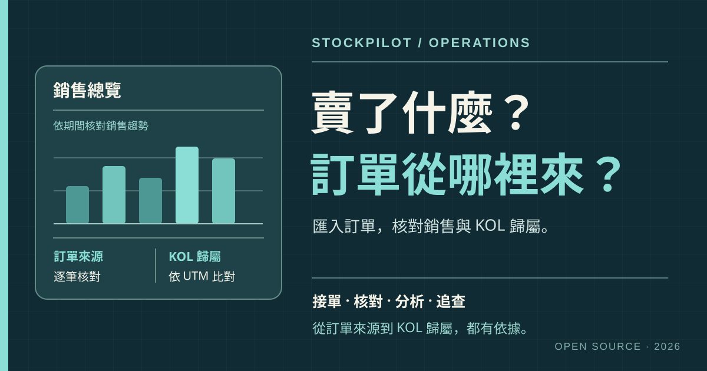

# StockPilot 營運系統

StockPilot 營運系統讓小型商家把分散在 Excel 的訂單整理成可核對的銷售紀錄：

- **訂單整理在一起：** 手動接單，或匯入檔案並預檢，確認後再計入銷售。
- **銷售狀況看得見：** 依期間、來源與商品查看銷售總覽及訂單明細。
- **行銷來源有依據：** 利用訂單中的 `utm_medium` 核對 KOL 歸屬；缺少標記時不自行推定。
- **AI 自然語言查詢：** 用日常用語詢問系統操作、訂單與 UTM 資料；目前只查詢已串接的資料，不會替你修改紀錄。

我曾從 0 到 1 主導一套內部營運系統的產品規劃，梳理商品管理與營運分析流程、定義功能需求，並與工程師協作完成建置。

StockPilot 營運系統將處理訂單、銷售與 KOL 歸屬的實務經驗整理成開源專案。

> **專案狀態：開發與驗收中。** 目前以本機單人使用為主；核心頁面已有實作，完整瀏覽器操作驗收、帳號權限與備份還原仍待完成。不建議直接用於正式營運。

## 為什麼做這個專案

不同通路的訂單分散在多份表格中，整理與核對都容易耗時：

- 各通路對同一商品使用的 SKU 與名稱可能不同，訂單狀態定義也可能不同。
- 訂單重複匯入、修訂或取消後，手工加總容易出錯。
- 要查一筆銷售或 KOL 歸屬，往往得回頭翻找原始檔案。

StockPilot 營運系統把接單到分析的流程整理成幾個可核對的步驟：

- 建立商品對照與訂單來源，再手動接單；若使用檔案匯入，先預檢，再確認。
- 保留來源與確認紀錄，按期間、來源和商品核對銷售明細。
- 有 `utm_medium` 才比對 KOL 歸屬；缺少標記時不自行推定。

營運資料獨立保存，不會自動建立出貨單或扣除庫存。

**UTM 是什麼？** UTM 是加在行銷連結上的追蹤參數。本系統使用訂單中的 `utm_medium` 比對 KOL 歸屬；`utm_source` 和 `utm_campaign` 則分別標示流量來源與活動。詳細定義可參考 [Google Analytics 的 UTM 說明](https://support.google.com/analytics/answer/10917952?hl=zh-Hant)。

## 第一次操作

1. 到「SKU 商品庫」建立一個測試商品，再到「訂單來源管理」建立自己的來源。
2. 到「接收訂單」手動建立一張測試訂單；保存後，在訂單列表核對來源、狀態和商品明細。
3. 到「銷售總覽」與「銷售查詢」查看金額與明細。想試檔案匯入時，依[訂單與銷售指南](docs/orders-sales.md)準備指定格式 Excel 或標準 CSV，先預檢，再確認匯入。

## 功能與操作

| 功能 | 目前可做的事 |
| --- | --- |
| 商品對照 | 在本系統建立訂單所需的 SKU；這份商品資料與倉管庫存無關 |
| 訂單接收 | 手動建立訂單，或上傳標準 CSV／指定格式 Excel，先預檢再確認 |
| 銷售總覽 | 按下單日期查看商品銷售金額、有效訂單數、品項數量與趨勢 |
| 銷售查詢 | 依期間、來源和品項篩選明細並匯出 CSV |
| KOL 分析 | 匯入 KOL 訂單 Excel、核對 UTM 歸屬與查看統計 |
| AI 助理 | 用自然語言詢問系統操作與已支援的唯讀資料查詢 |

一個營運流程是：建立本系統的商品對照與訂單來源 → 接收或匯入訂單 → 預檢並確認 → 查看銷售總覽和明細 → 核對 KOL 歸屬。取消訂單保留紀錄，但不計入有效銷售。

## 操作指南

- [訂單與銷售指南](docs/orders-sales.md)：手動接單、檔案預檢與銷售查詢。
- [KOL 分析指南](docs/kol-analysis.md)：KOL 商品對照、Excel 匯入與 UTM 核對。

## 已知問題與使用提醒

- **尚未驗證大量訂單情境：** 目前的本機配置尚未針對大量訂單或多人同時使用驗證；標準 CSV 每批最多 5,000 列、2 MB。若有這類需求，需先評估效能並調整部署；也歡迎[聯絡我](#聯絡我)討論合作。
- **匯入與分析仍待完整驗收：** 本專案尚未完成真實瀏覽器中的訂單匯入、銷售查詢與 KOL 分析全流程驗收，請先用測試資料試跑。
- **UTM 歸屬取決於來源資料：** 訂單若缺少 `utm_medium`，系統不會自行推定 KOL 歸屬。
- **目前以本機單人使用為主：** 尚無帳號權限或自動備份；資料儲存在本機 `.local/workspace.sqlite3`，不會隨 GitHub 儲存庫備份。

## 授權

本專案採用 [MIT License](LICENSE)。第三方 ECharts 的授權與 NOTICE 位於 `web/vendor/echarts-6.1.0/`。

## 聯絡我

我是 [Ed Chen](https://github.com/EdChen0321)。如果你遇到操作問題，或需要擴充資料量、調整訂單與銷售流程，歡迎到本專案的 [GitHub Issues](https://github.com/EdChen0321/StockPilot-Operations/issues) 留言討論合作。公開留言請勿附上真實顧客、訂單或其他個資。
